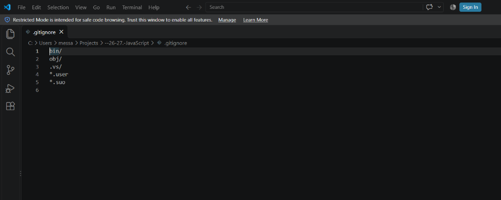
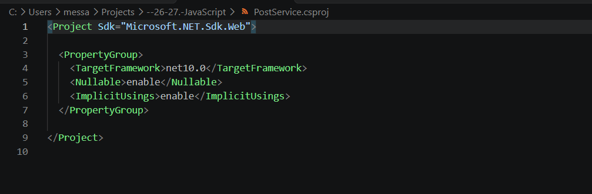
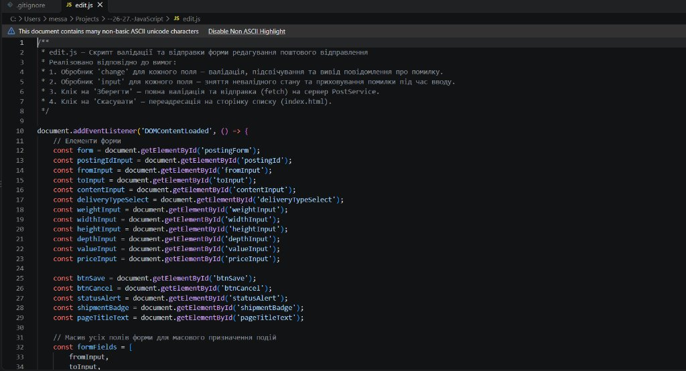
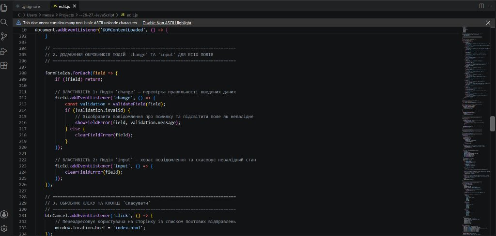
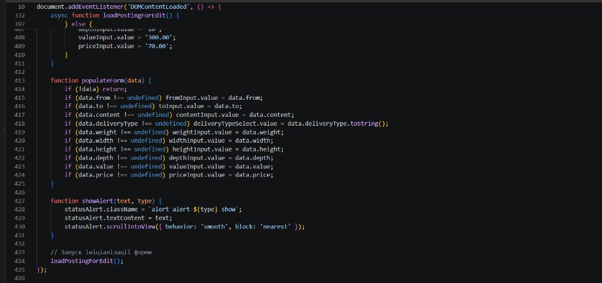
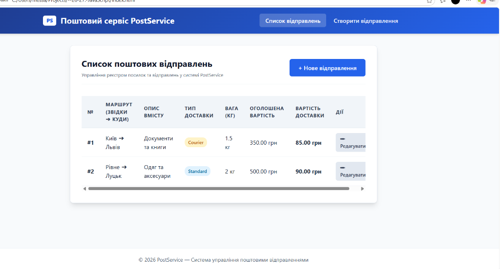

# Практична робота №26–27: Валідація форми редагування поштового відправлення та інтеграція з API

**Тема:** Розробка сторінки редагування даних (edit.html), реалізація валідації форми засобами JavaScript та взаємодія з REST API (PostService).  
**Мета:** Навчитися розробляти інтерактивні форми для редагування сутностей, опрацьовувати події введення (`input`, `change`), реалізовувати валідацію числових та текстових полів з візуальним підсвічуванням помилок, виконувати збереження даних на сервер за допомогою Fetch API (GET, POST, PUT) та організовувати навігацію між сторінкою списку і формою редагування.

---

## Хід роботи та скріншоти виконання

### 1. Конфігурація проєкту та файл виключень (.gitignore)
Налаштовано структуру веб-додатку на базі ASP.NET Core (`PostService.csproj`) та створено файл `.gitignore` для виключення бінарних файлів збірки (`bin/`, `obj/`, `.vs/`).





---

### 2. Реалізація JavaScript-скрипту валідації та інтеграції (edit.js)

#### 2.1. Ініціалізація форми та отримання посилань на елементи
Створено змінні для доступу до всіх полів форми (`fromInput`, `toInput`, `contentInput`, `weightInput`, `priceInput` тощо) та масив `formFields` для пакетного призначення обробників подій.



#### 2.2. Обробка подій `change` та `input`
- **Подія `change`:** виконує перевірку правильності введених даних після втрати фокусу або завершення введення. У разі помилки викликається `showFieldError` (додається клас підсвічування та виводиться підказка).
- **Подія `input`:** спрацьовує безпосередньо під час набору символів і автоматично знімає стан помилки (`clearFieldError`), щоб не дратувати користувача.
- **Обробник «Скасувати»:** повертає користувача до сторінки реєстру відправлень (`index.html`).



#### 2.3. Завантаження даних відправлення та заповнення форми
Реалізовано функції `loadPostingForEdit()` (отримання параметрів через `URLSearchParams` і GET-запит до API) та `populateForm()` для автоматичного заповнення форми при редагуванні існуючого відправлення.



---

### 3. Робота інтерфейсу користувача в браузері

#### 3.1. Реєстр поштових відправлень (index.html)
Сторінка відображає актуальний список усіх поштових посилок у системі, маршрут (звідки ➔ куди), опис, тип доставки, вагу, оголошену вартість, ціну доставки та дію швидкого переходу до редагування.



#### 3.2. Форма створення / редагування відправлення (edit.html)
Сторінка містить структуровані блоки введення інформації: адресати та маршрут доставки, опис вмісту, тип доставки, вага, габарити посилки (ширина, висота, довжина) та фінансові параметри.


---

## Контрольні запитання

### 1. Чим відрізняється подія `change` від події `input` у формах?
**Відповідь:**  
- Подія `input` спрацьовує миттєво під час кожного введення чи видалення символу користувачем. Її зручно використовувати для зняття помилок валідації або «живого» підрахунку вартості.
- Подія `change` виникає лише тоді, коли елемент втрачає фокус (blur) і його значення змінилося порівняно з початковим, або при зміні вибору у випадаючому списку `<select>`. Вона підходить для фінальної перевірки правильності заповнення конкретного поля.

---

### 2. Як отримати параметри запиту (query parameters) з адреси сторінки в JavaScript?
**Відповідь:**  
За допомогою вбудованого об'єкта `URLSearchParams`:
```javascript
const urlParams = new URLSearchParams(window.location.search);
const id = urlParams.get('id'); // Отримання значення параметра ?id=...
```

---

### 3. Які HTTP-методи використовуються при роботі з формою редагування/створення?
**Відповідь:**  
- **GET:** для завантаження наявних даних об'єкта за його ідентифікатором (`/postings/{id}`).
- **POST:** для створення нового поштового відправлення, якщо форма відкрита в режимі створення нового запису.
- **PUT:** для повного оновлення існуючого відправлення за його id (`/postings/{id}`).

---

### 4. Як реалізується валідація числових полів на стороні клієнта?
**Відповідь:**  
Значення зчитується з `input.value`, приводиться до числа через `parseFloat()` або `Number()` та перевіряється:
- Чи є воно коректним числом (`!isNaN(val)`);
- Чи задовольняє діапазон (наприклад, вага > 0 та <= 1000 кг);
- Чи заповнене обов'язкове поле (`val.trim() !== ''`).  
У разі помилки полю додається CSS-клас помилки (наприклад, `is-invalid`) та поруч виводиться пояснювальне повідомлення.

---

## Висновок
Під час виконання практичної роботи №26–27 було розроблено повнофункціональну сторінку редагування та створення поштових відправлень `edit.html` з інтеграцією до бекенду PostService. На практиці реалізовано динамічну клієнтську валідацію форми за подіями `change` та `input`, налаштовано автоматичне завантаження даних за ID через `URLSearchParams` і Fetch API, а також забезпечено зручний перехід між реєстром відправлень та формою.
